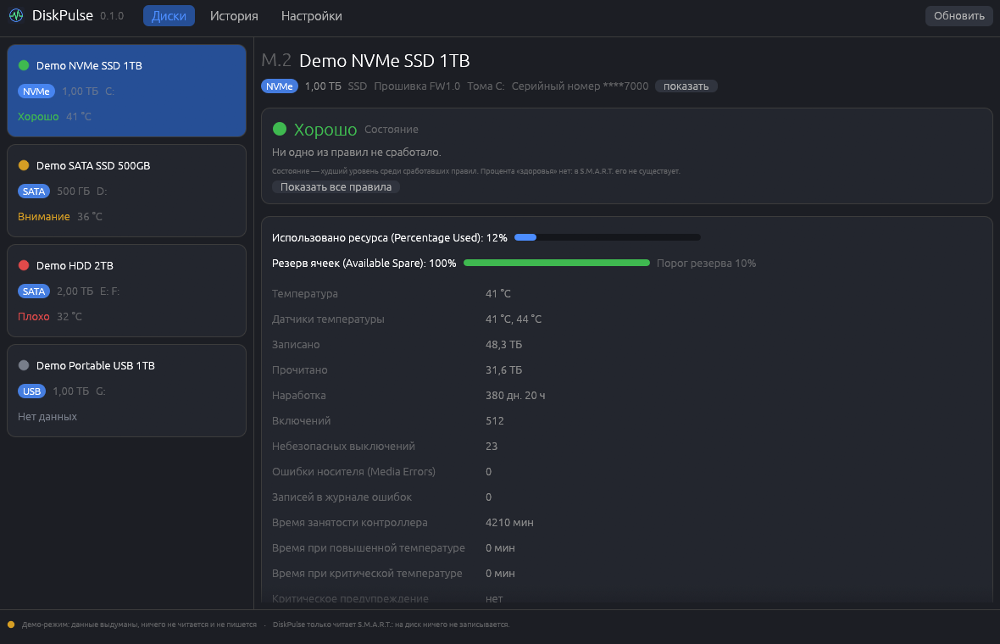
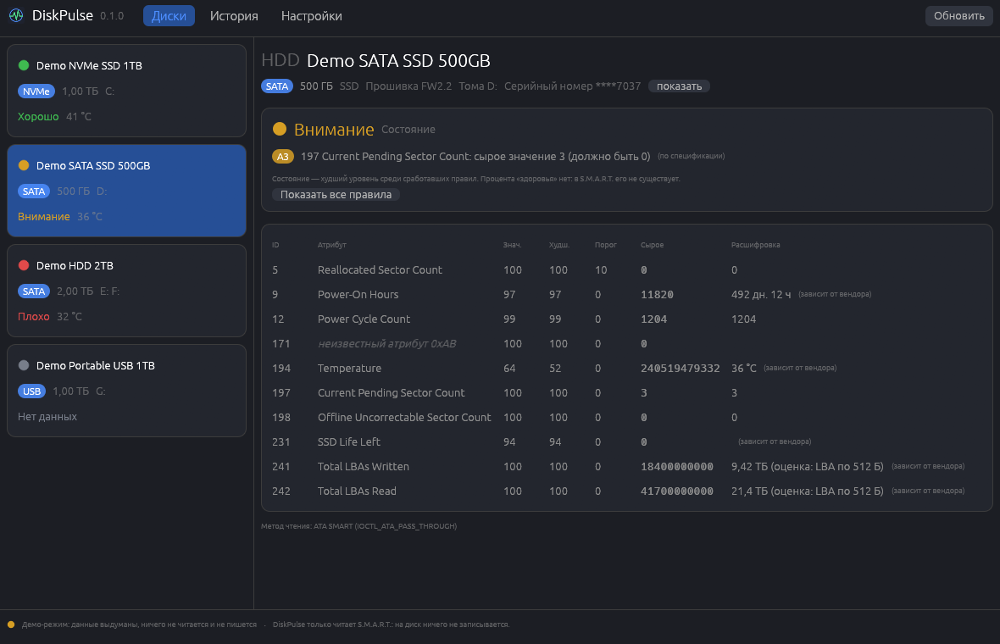
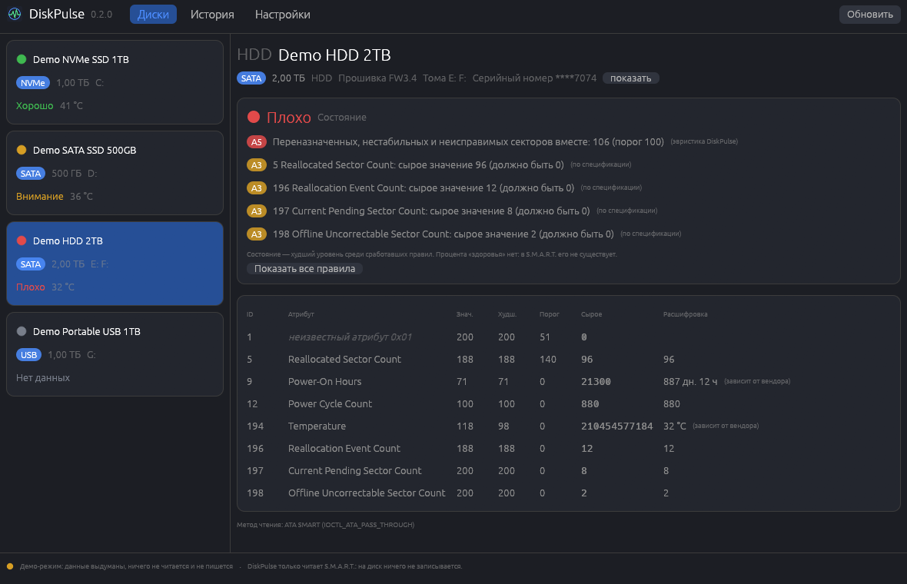
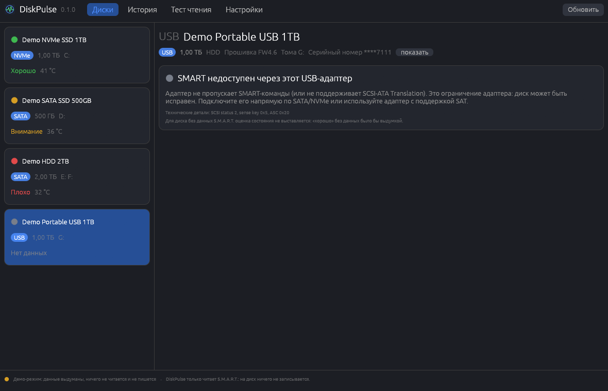
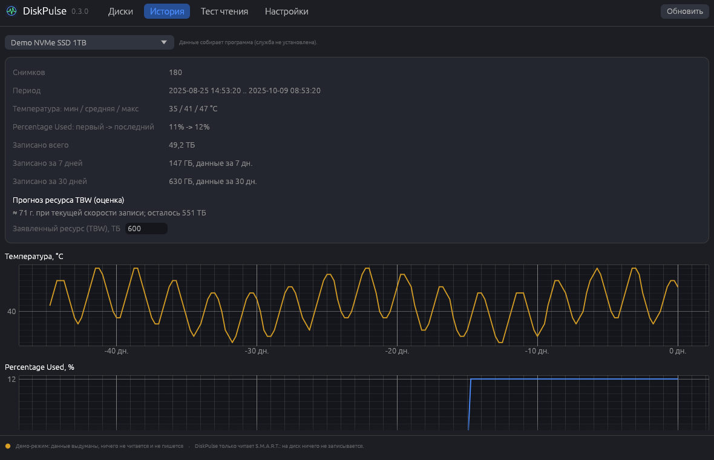

# DiskPulse

[English](README.en.md) · [Русский](README.md)

Disk health for Windows (in the spirit of CrystalDiskInfo): S.M.A.R.T. for NVMe, SATA and external USB drives,
a verdict from transparent rules, and honest statuses where a drive gives nothing. DiskPulse only reads:
nothing is ever written to a disk.



*All screenshots use invented data (`DiskPulse.exe --demo`) — no real model names or serial numbers.*

## Features (version 0.2.0)

- **Disks.** Every physical disk (`\\.\PhysicalDriveN`): model, bus, size, HDD/SSD, firmware, volume letters.
  The serial number is masked (`****1234`); a button reveals it.
- **NVMe.** Log page 02h (SMART/Health): temperature and sensors, Percentage Used, Available Spare and its threshold,
  data written/read, power-on time, power cycles, unsafe shutdowns, Media Errors, critical warning. Read through
  `IOCTL_STORAGE_QUERY_PROPERTY`; on the tested machine this works without administrator rights.
- **SATA.** The ATA SMART attribute table with thresholds. Attributes 5, 9, 12, 177, 187, 194, 196-198, 231, 233, 241
  and 242 are decoded (vendor-dependent ones are marked); unknown attributes are shown as they are (ID and raw value).
  Read through `IOCTL_ATA_PASS_THROUGH`, with `SMART_RCV_DRIVE_DATA` as a fallback. Needs administrator rights.
- **USB.** SCSI-ATA Translation (ATA PASS-THROUGH 16, then 12). If the adapter blocks the commands or answers with
  garbage, DiskPulse says "SMART is unavailable through this USB adapter" instead of showing zeros. Vendor NVMe bridges
  (JMicron, ASMedia, Realtek) are **not implemented**.
- **Transparent assessment.** "Good / warning / bad" is the worst level among the rules that fired, and the rules are
  listed (`N6 - media errors: 7`, `A5 - ...`). Each rule shows its basis: specification, vendor or DiskPulse heuristic.
  There is no "health percentage": S.M.A.R.T. does not contain one. A disk without data gets no verdict at all.
- **Administrator rights** are needed only for SATA/USB. The main window stays unelevated; "Open as administrator"
  starts a separate window (one UAC prompt).
- **Auto-update** from GitHub Releases with SHA-256 verification against `SHA256SUMS.txt` (once a day, can be turned
  off; `DiskPulse.exe --update` does the same without a window).
- Russian and English UI (switch in settings), log and crash reports, demo mode.
- `diskpulse-cli`: `list`, `smart <disk> [--json]`.
- **History and charts.** S.M.A.R.T. snapshots every 30 minutes (configurable) and at startup are written to JSON-lines files
  (`%APPDATA%\DiskPulse\history`, or `%ProgramData%\DiskPulse\history` when the service is installed). No SQLite: it is a native C
  library, and the data is a few hundred bytes per snapshot appended in order. Old data is thinned: everything for 2 days, then
  one snapshot per hour up to 30 days, then one per day up to 5 years. The "History" tab shows charts of temperature, Percentage
  Used and written volume; "written in 7 / 30 days" comes from counter differences (Data Units Written), handling wrap-around of
  narrow counters and resets (drive replaced, firmware reset). For SATA the written volume is an estimate from attribute 241.
  The **TBW forecast** is built only if you enter the drive's rated TBW and at least 3 days of writes have been collected; it is
  labelled "estimate" and assumes the write rate stays the same.
- **Tray.** `DiskPulse.exe --tray` (autostart in settings): an icon coloured by the worst disk status and Windows notifications
  about overheating (configurable threshold), growth of Media Errors / reallocated / pending sectors, a drop in Available
  Spare, a sharp jump in writes and the critical warning. The same notification for the same disk is shown at most once a day.
  The tray also checks for updates once a day and reports a new version. Without administrator rights the tray reads NVMe only.
- **`DiskPulseCollector` service (optional).** Collects snapshots in the background with no window and no logged-in user, with
  administrator rights (so it reads SATA too). Install and removal take one UAC prompt from the settings. The executable is
  copied to `%ProgramFiles%\DiskPulse` (a normal user cannot write there); the service only writes history and reads its own
  `service.json` (values are clamped). The tray shows the notifications.
- `diskpulse-cli`: new `collect` and `history [disk] [--json] [--set-tbw TB]`.

| SATA SSD | HDD with errors | USB without SMART |
| --- | --- | --- |
|  |  |  |



## Installation

Download `DiskPulse-Setup.exe` from [Releases](https://github.com/ahsoggg-creator/diskpulse/releases/latest) and
run it. No administrator rights are needed: it installs into `%LOCALAPPDATA%\Programs\DiskPulse`, adds a Start menu
shortcut and an "Apps & features" entry. A portable `DiskPulse.exe` is also provided (it can install itself later from
the settings). Silent install: `DiskPulse-Setup.exe --install --silent`; uninstall: `DiskPulse.exe --uninstall`
(or `--uninstall --silent`).

### Code signing and SmartScreen

Release executables are **unsigned**: SmartScreen may show "unknown publisher". Verify `SHA256SUMS.txt`. To sign your
own builds with a self-signed certificate, use `scripts/make_cert.ps1`, `scripts/trust_cert.ps1` and
`scripts/release.ps1`; the private key stays on your machine and `*.pfx` files are excluded from git.

## Limitations (honestly)

- USB bridges often block SMART; attribute values are interpreted differently by different vendors (marked "vendor
  dependent"); an LBA on an SSD is not a physical cell.
- Some assessment rules are heuristics (and labelled so); they are not a substitute for backups.
- Verified on real NVMe drives (see `crates/core/tests/fixtures`). The SATA and USB paths follow the specifications and
  are covered by byte-sample tests; how they behave on a particular drive depends on its driver and adapter.

## Diagnostics and privacy

DiskPulse sends nothing anywhere except the update check on GitHub. There is no telemetry.

- `%APPDATA%\DiskPulse\history` - the snapshot history (model, masked serial number, counters);
- `%APPDATA%\DiskPulse\logs\diskpulse.log` - the log (rotated at 512 KB);
- `%APPDATA%\DiskPulse\logs\crashes\crash-<time>.txt` - a crash report: version, panic location, backtrace, log tail.

Disk serial numbers are masked (`****1234`) in the log and reports and never appear in full in JSON output.
Settings -> "Diagnostics" opens the logs folder or copies the diagnostic text.

## Building

Rust (stable, edition 2024) and MSVC are required.

```powershell
cargo build --release     # target\release\DiskPulse.exe and diskpulse-cli.exe
cargo test --workspace
powershell -ExecutionPolicy Bypass -File scripts\release.ps1   # checks, build, dist\ with SHA256SUMS.txt
```

Layout:

- `crates/core` - NVMe/ATA parsers, transports, disk enumeration, assessment rules, history, alerts, localization (no UI, with tests);
- `crates/app` - egui GUI, installer, auto-update, diagnostics, demo mode;
- `crates/cli` - `diskpulse-cli list`, `smart 0 --json`, `collect`, `history`.

The same exe is the installer when it is named `DiskPulse-Setup.exe` (or started with `--install`) and the uninstaller
with `--uninstall`. Re-create the screenshots (invented data, nothing real is read): `DiskPulse.exe --screenshots docs\screenshots`.

## License

Your choice of the [Apache License 2.0](LICENSE-APACHE) or the [MIT license](LICENSE-MIT).
