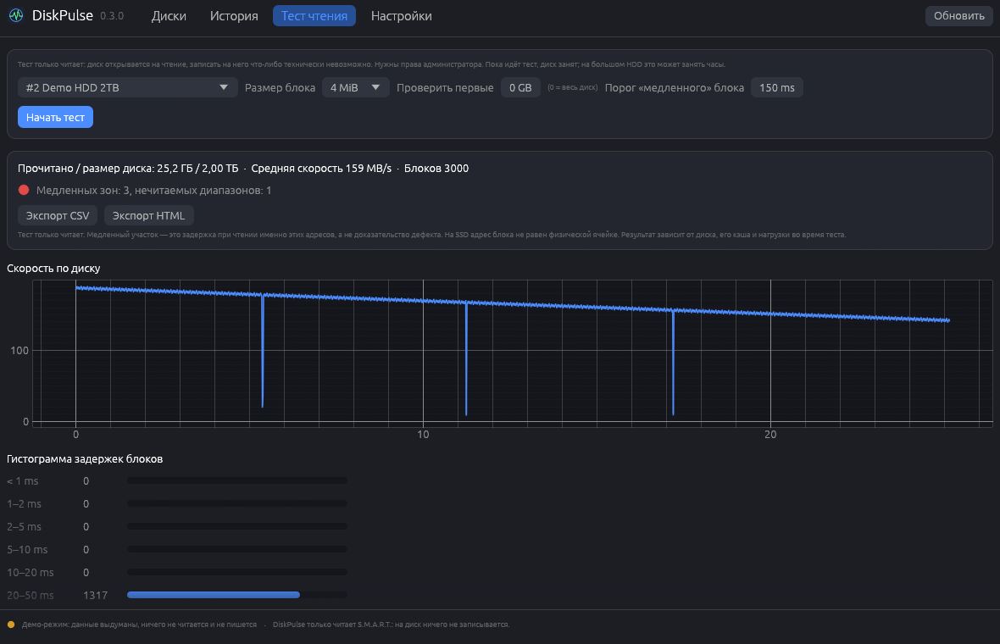

# DiskPulse

[English](README.en.md) · [Русский](README.md)

Состояние дисков для Windows (в духе CrystalDiskInfo): S.M.A.R.T. у NVMe, SATA и внешних USB-дисков,
оценка по прозрачным правилам и честные статусы там, где диск ничего не отдаёт. DiskPulse только читает:
на диск ничего не записывается.


*Все скриншоты сделаны на выдуманных данных (`DiskPulse.exe --demo`) — настоящих моделей и серийных номеров на них нет.*

## Возможности (версия 0.3.0)

- **Диски.** Все физические диски (`\\.\PhysicalDriveN`): модель, шина, объём, HDD/SSD, прошивка, буквы томов.
  Серийный номер скрыт (`****1234`), показать его можно кнопкой.
- **NVMe.** Лог-страница 02h (SMART/Health): температура и датчики, Percentage Used, Available Spare и его порог,
  записано/прочитано, наработка, включения, небезопасные выключения, Media Errors, критическое предупреждение.
  Читается через `IOCTL_STORAGE_QUERY_PROPERTY` — на проверенной машине без прав администратора.
- **SATA.** Таблица атрибутов ATA SMART с порогами. Расшифрованы атрибуты 5, 9, 12, 177, 187, 194, 196–198, 231, 233,
  241, 242 (там, где единицы зависят от вендора, это помечено), неизвестные показываются как есть (ID и сырое значение).
  Чтение — `IOCTL_ATA_PASS_THROUGH`, запасной путь — `SMART_RCV_DRIVE_DATA`. Нужны права администратора.
- **USB.** SCSI-ATA Translation (ATA PASS-THROUGH 16, затем 12). Если адаптер блокирует команды или отвечает
  мусором, DiskPulse пишет «SMART недоступен через этот USB-адаптер», а не нули. Вендорные NVMe-мосты
  (JMicron, ASMedia, Realtek) **не реализованы**.
- **Оценка по прозрачным правилам.** «Хорошо / внимание / плохо» — худший уровень среди сработавших правил, а сами
  правила показаны (`N6 — ошибки носителя: 7`, `A5 — …`). У каждого правила видно, на чём оно основано: спецификация,
  вендор или эвристика DiskPulse. «Процента здоровья» нет: в S.M.A.R.T. его не существует. Диск без данных не получает
  оценки вообще.
- **Права администратора** нужны только для SATA/USB. Основное окно остаётся без повышения; «Открыть от
  администратора» запускает отдельное окно (один запрос UAC).
- **Автообновление** из GitHub Releases с проверкой SHA-256 по `SHA256SUMS.txt` (раз в сутки, отключается в настройках;
  `DiskPulse.exe --update` делает то же без окна).
- Интерфейс на русском и английском (переключатель в настройках), журнал и отчёты о сбое, демо-режим.
- `diskpulse-cli`: `list`, `smart <диск> [--json]`.
- **История и графики.** Снимки S.M.A.R.T. раз в 30 минут (интервал настраивается) и при запуске пишутся в файлы JSON Lines
  (`%APPDATA%\DiskPulse\history`, при установленной службе — `%ProgramData%\DiskPulse\history`). SQLite не нужен: это нативная
  C-библиотека, а данные — несколько сотен байт на снимок, дописываемые по порядку. Старые данные прореживаются: всё за 2 суток,
  потом по снимку в час до 30 дней, потом по снимку в сутки до 5 лет. Вкладка «История»: графики температуры, Percentage Used и
  объёма записи; «записано за 7 / 30 дней» считается по разности счётчиков (Data Units Written) с учётом переполнения узких
  счётчиков и сброса (замена диска, сброс прошивки). Для SATA объём записи — оценка по атрибуту 241. **Прогноз ресурса TBW** строится
  только если вы указали заявленный TBW диска и накоплено хотя бы 3 дня записей; он помечен «оценка» и предполагает, что скорость
  записи не изменится.
- **Трей.** `DiskPulse.exe --tray` (автозапуск — в настройках): значок цвета худшего статуса дисков, уведомления Windows о
  перегреве (порог настраивается), росте Media Errors / переназначенных / нестабильных секторов, падении Available Spare, резком
  скачке записи и критическом предупреждении. Одно и то же уведомление для одного диска — не чаще раза в сутки. Раз в сутки
  проверяется обновление, о новой версии трей тоже сообщает. Без прав администратора трей читает только NVMe.
- **Служба `DiskPulseCollector` (по желанию).** Собирает снимки в фоне без окна и без вашего входа в систему, с правами
  администратора (читает и SATA). Установка и удаление — один запрос UAC из настроек. Исполняемый файл копируется в
  `%ProgramFiles%\DiskPulse` (туда обычный пользователь писать не может); служба только пишет историю и читает свой `service.json`
  (значения ограничены). Уведомления показывает трей.
- `diskpulse-cli`: добавились `collect` и `history [диск] [--json] [--set-tbw ТБ]`.
- **Тест чтения (только чтение).** Физический диск открывается с `GENERIC_READ` и `FILE_FLAG_NO_BUFFERING`; в модуле теста нет
  ни одной операции записи (это проверяет тест, читающий исходник модуля). Блоки по 1–8 МиБ подряд, время каждого блока, график
  скорости, гистограмма задержек (11 корзин: от «< 1 мс» до «≥ 1 с»), «медленные зоны» — соседние блоки дольше порога (по умолчанию
  150 мс, настраивается), отмена в любой момент. Блок, который не читается, перечитывается по 4 КиБ, чтобы найти точные нечитаемые
  сектора; после 2000 таких диапазонов тест останавливается. Нужны права администратора. Результат зависит от диска, его кэша и
  нагрузки; на SSD адрес блока не равен физической ячейке.
- **Какие файлы лежат в медленных зонах.** Смещение на диске → кластеры тома (смещение раздела вычитается) → владелец кластера по
  `$MFT` (разбор data runs, записи расширения, удалённые файлы игнорируются) и `$Bitmap` для свободного места. По каждой зоне:
  файлы и папки с путями, служебные файлы NTFS, свободное место, «занято, владелец не найден». Только NTFS и тома из одного участка
  диска; для остальных пишется причина. Для нечитаемых блоков — отдельный список с файлами.
- Экспорт отчёта в CSV и HTML (все данные с диска экранируются); `diskpulse-cli scan <диск> [--csv файл] [--html файл] [--json]
  [--block-mib 4] [--start-gb N] [--len-gb N] [--slow-ms 150]`.

| SATA SSD | HDD с ошибками | USB без SMART |
| --- | --- | --- |
|  |  |  |




## Установка

Скачайте `DiskPulse-Setup.exe` со страницы [Releases](https://github.com/ahsoggg-creator/diskpulse/releases/latest)
и запустите. Права администратора не нужны — программа ставится в `%LOCALAPPDATA%\Programs\DiskPulse`, добавляет
ярлык в меню «Пуск» и запись в «Приложения и возможности». Есть и переносная версия — просто `DiskPulse.exe`
(установить можно позже из настроек). Тихая установка: `DiskPulse-Setup.exe --install --silent`, удаление:
`DiskPulse.exe --uninstall` (или `--uninstall --silent`).

### Подпись кода и SmartScreen

Исполняемые файлы релизов **не подписаны**: SmartScreen может показать «неизвестный издатель». Сверяйте
`SHA256SUMS.txt`. Если хотите подписывать собственные сборки самоподписанным сертификатом, есть скрипты
`scripts/make_cert.ps1`, `scripts/trust_cert.ps1` и `scripts/release.ps1`; закрытый ключ хранится только локально,
файлы `*.pfx` исключены из git.

## Ограничения (честно)

- USB-мосты часто блокируют SMART; значения атрибутов у разных вендоров трактуются по-разному (помечено
  «зависит от вендора»); адрес блока на SSD не равен физической ячейке.
- Правила оценки частично эвристические (так и помечены); они не заменяют резервные копии.
- Скорости в README не приводятся: см. [docs/BENCHMARKS.md](docs/BENCHMARKS.md) — там только измеренное и методика.
- Проверено на реальных NVMe-дисках (см. `crates/core/tests/fixtures`). SATA и USB-пути написаны по спецификациям и
  покрыты тестами на байтовых образцах; их работа на конкретном железе зависит от драйвера и адаптера.

## Тест чтения не пишет на диск

Физический диск в тесте открывается функцией `Device::open_read_only_unbuffered` (`GENERIC_READ`, без `GENERIC_WRITE`), единственная операция
источника блоков — `read_at`, а модуль `surface.rs` не содержит ни `WriteFile`, ни `DeviceIoControl`, ни `GENERIC_WRITE`: это проверяет
модульный тест `this_module_cannot_write`. Для просмотра файлов том открывается тем же путём, только на чтение.

## Диагностика и приватность

DiskPulse ничего никуда не отправляет, кроме проверки обновлений на GitHub. Телеметрии нет.

- `%APPDATA%\DiskPulse\history` — история снимков (модель, замаскированный серийный номер, счётчики);
- `%APPDATA%\DiskPulse\logs\diskpulse.log` — журнал (ротация при 512 КБ);
- `%APPDATA%\DiskPulse\logs\crashes\crash-<время>.txt` — отчёт о сбое: версия, место паники, стек, хвост журнала.

Серийные номера дисков маскируются (`****1234`) в журнале и отчётах и не попадают в JSON-вывод целиком.
Настройки → «Диагностика» открывают папку журналов или копируют диагностический текст.

## Сборка

Нужен Rust (stable, edition 2024) и MSVC.

```powershell
cargo build --release     # target\release\DiskPulse.exe и diskpulse-cli.exe
cargo test --workspace
powershell -ExecutionPolicy Bypass -File scripts\release.ps1   # проверки, сборка, dist\ с SHA256SUMS.txt
```

Структура:

- `crates/core` — парсеры NVMe/ATA, транспорты, перечисление дисков, правила оценки, история, уведомления, тест чтения, разбор NTFS, отчёты, локализация (без UI, с тестами);
- `crates/app` — GUI на egui, установщик, автообновление, диагностика, демо-режим;
- `crates/cli` — `diskpulse-cli list`, `smart 0 --json`, `collect`, `history`, `scan`.

Тот же exe — установщик, если называется `DiskPulse-Setup.exe` (или запущен с `--install`), и деинсталлятор с `--uninstall`.
Пересоздать скриншоты (выдуманные данные, ничего реального не читается): `DiskPulse.exe --screenshots docs\screenshots`.

## Лицензия

На ваш выбор: [Apache License 2.0](LICENSE-APACHE) или [лицензия MIT](LICENSE-MIT).
